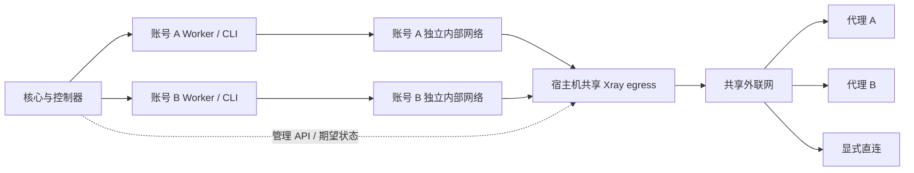

# CCGateway 共享 Xray 出口改造方案

实施状态（2026-10-15）：控制器与共享出口首版已实现；实际部署进度见环境运行记录。首版以 CONTRACTS 第 57 节为准：DNS 不缓存，网络池修改先回迁，旧 egress 停止保留；严格每请求版本屏障仍不在本轮范围。

日期：2026-10-15。

状态：设计提案，基础可行性已完成隔离验证，尚未实现到生产代码。线上仍使用每账号独立的 sing-box egress。本文中的新接口、状态字段和能力标记都是拟议合同，不代表当前已经支持；现行行为仍以 [CONTRACTS](CONTRACTS.md) 为准。

第一阶段以控制器及出口组件为主，复用现有核心、前端和 Worker 协议。具体执行见[控制器迁移方案](CCGATEWAY-XRAY-MIGRATION.md)，日常代理修改见[端到端同步设计](CCGATEWAY-XRAY-PROXY-SYNC.md)。

## 1. 改造目标与边界

将“每个账号一个 sing-box 出口容器”改为“每台 Docker 宿主机一个共享 Xray 出口服务”，根据 Worker 的容器源 IP 选择该账号绑定的代理。

目标：

- 减少出口容器、独立外联网及代理进程的数量。
- 通过管理 API 动态增加代理、更新账号映射和撤销映射，日常变更不重启共享 Xray。
- 代理切换后，新连接使用新代理；已有连接可以沿原代理自然结束。
- 保留每账号独立的内部网络、Worker、配置和数据卷。
- 保持现有 HTTP、HTTPS、SOCKS5 代理及显式直连语义。
- 代理未就绪、映射未知或状态恢复不完整时拒绝新流量，不自动改用其他账号代理或直连。

本次不改对外 API 请求格式、账号调度算法、Worker 与 CLI 的 stream-json/Mod 内容交互、工具执行归属、会话历史和计费逻辑。内部出口修订头及 Worker 每请求准入属于后续增强，不是首轮迁移前提。Xray 不解析模型 JSON，不解密模型 HTTPS。

共享范围是同一 Docker 宿主机，不是跨宿主机的全局单实例。不同宿主机可能复用内网 IP，不能仅靠 IP 在全局识别账号；控制面标识至少包含宿主机身份和运行环境身份。

## 2. 当前实现与目标拓扑

当前主路径：

```text
客户端 API → 核心 → 账号隧道 → Worker → CC CLI
                                          ↓
                               账号内部网 → 账号 sing-box → 代理/直连
```

目前控制器生成每账号的 `sing-box.json` 和 `firewall.nft`，配置 app 默认路由，并维护 `ccg-<key>-net`、`ccg-<key>-uplink`。app 设置 `CCG_EXTERNAL_EGRESS=1`，子进程不依赖 HTTP_PROXY 等显式代理变量。

目标拓扑：



共享 egress 接入每个账号的内部网络，在每个网络中拥有独立网关地址；另接入一张共享 uplink。Worker 不连接 uplink。源 IP 到达 TPROXY 前不得被 SNAT，Xray 必须看到原始 Worker 地址。

保留现有地址分配器的网段冲突检查，扩展共享网关地址分配与引用计数。网络规模较大时，多网卡数量、Docker endpoint 上限和路由规模必须先压测，不在本期假定可无限扩展。

## 3. 已完成的隔离验证

验证版本：官方 Xray-core `v26.3.27`，程序报告源码 `d2758a0`，Linux amd64。下载包 `Xray-linux-64.zip` 的 SHA-256：

```text
23cd9af937744d97776ee35ecad4972cf4b2109d1e0fe6be9930467608f7c8ae
```

验证环境为三个临时 internal Docker 网络、两个模拟账号容器、一个未知来源容器、一个共享 Xray，以及模拟 HTTPS 上游与三个代理。未使用生产凭据，未修改生产路由，临时容器和网络已清理。

| 用例 | 实测结果 |
| --- | --- |
| A、B 位于不同内部网络，按源 IP 分流 | A 经 HTTP 代理 A，B 经 HTTP 代理 B |
| 未登记源 IP 请求 | 拒绝，未落到其他代理 |
| 通过 `ado` 动态增加 SOCKS5 代理 C | 成功，无进程重启 |
| 通过 `adrules` 替换路由，把 A 指向 C | A 的新连接经 C，B 仍经 B |
| A 已有 SSE 期间切换路由并 `rmo` 删除旧出站 | 原连接仍经 A，连续收到 150 条消息，约 30 秒，无丢序或中断 |
| A 改为拒绝，再恢复到 C | 拒绝和恢复均生效，B 不受影响 |
| 全过程进程身份 | PID、StartedAt 不变 |

原始结果：[隔离测试记录](ccgateway-migration/evidence/xray-egress-poc-20261015.json)。本地试验脚本位于仓库根 `artifacts/xray-egress-poc/`，该目录不是正式发布产物；进入实现阶段时，应将整理后的可重复夹具纳入组件测试目录，避免依赖本机 artifacts。

证据限制：此次测试是固定版本上的模拟 HTTPS/SSE，不是实际 CC 模型请求；不覆盖代理认证、HTTPS 上游代理、DNS 分流、UDP、高并发、进程崩溃恢复、整机重启及旧连接的长期资源回收。删除旧出站不切断这次连接，不等于所有出站类型和所有版本均有同样语义。

## 4. 组件职责和身份模型

| 组件 | 改造后的职责 |
| --- | --- |
| 核心 | 保存账号与代理绑定、出口模式、管理员操作；产生可校验的期望修订号；根据账号运行环境就绪状态决定能否建立新隧道 |
| 控制器 | 本宿主机唯一写入者；维护容器/IP 身份、代理版本、持久期望状态；协调 Xray API、DNS 和 nftables；探测后发布就绪 |
| Xray | TPROXY 入站、源 IP 匹配、按指定出站建立连接；不负责业务账号数据库 |
| DNS 组件 | 按原始查询来源选择相同的账号出口策略，并隔离解析缓存；具体实现见第 7 节 |
| Worker / CLI | 保持现有协议、认证和内容交互；不持有出口代理凭据，不自行选择出口 |

数据面按源 IP 匹配，控制面不能把 IP 当成永久身份。每条映射至少记录：

```text
host_id + runtime_key + container_id + network_id + source_ip
account_id（草稿可为空）
backend = per_account_singbox | shared_xray
desired_revision / applied_revision
binding_generation / proxy_revision / outbound_tag
state / reason / xray_boot_id
```

`runtime_key` 沿用数字 key 或草稿 key，草稿认领后不重命名。`binding_generation` 在身份被替换时递增，防止迟到任务把旧 IP 绑定重新写回。只从控制器确认的 Docker endpoint 获取 IP，不接受 Worker 请求头自报身份。

## 5. 出口与路由配置

### 5.1 代理节点

一个代理配置版本对应一个不可变出站，如 `proxy-12-r7`。多个账号绑定完全相同的代理版本时可复用出站。地址、协议或凭据变化时创建新版本，不通过“先删除同名节点再添加”覆盖正在使用的节点。

出站至少支持 HTTP CONNECT、HTTPS CONNECT、SOCKS5 和显式直连。HTTPS 代理的服务器证书及 SNI 校验必须保留。不得使用关闭证书验证来通过验收。

默认出站为 `blackhole`；最终匹配规则也拒绝。不存在的出站标签、空路由或恢复中的映射不能导致默认直连。直连账号必须有显式映射和公网目标限制。

### 5.2 账号路由

固定 TPROXY 入站，账号路由使用精确 `/32` 源地址匹配，出站为对应不可变 tag。例如，下列是固定验证版本的配置片段，不是可直接部署的完整配置：

```json
{
  "routing": {
    "domainStrategy": "AsIs",
    "rules": [
      {"type": "field", "ruleTag": "runtime-a-g1", "source": ["10.251.17.10/32"], "outboundTag": "proxy-12-r7"},
      {"type": "field", "ruleTag": "deny-unknown", "network": "tcp,udp", "outboundTag": "block"}
    ]
  }
}
```

管理入站和 DNS 专用入站的规则在账号规则之前，避免管理连接落入最终拒绝规则。此版本试验使用 `dokodemo-door`、`followRedirect` 和 `sockopt.tproxy`；不要直接复制最新版文档中已经改名的配置字段。

### 5.3 内核规则

- 在共享 egress 命名空间配置 TPROXY、fwmark 和本地策略路由；不开启普通 IP forwarding。
- 来源检查同时约束入口接口和已登记源 IP，防止另一个内部网络伪造来源；Worker 保持非 root、移除 NET_ADMIN/NET_RAW。
- app 的普通内网访问限制继续生效；仅放行自己的 DNS 网关、本机 Mod 控制端口和允许的外部业务连接。
- 共享 egress 出站白名单覆盖当前及排空中的代理端点。代理切换时先加入新端点，旧连接结束后再移除旧端点。
- 某账号启用直连会扩大共享进程所需的内核放行范围；精确账号出口约束因此还依赖 Xray 规则。必须在文档和状态中保留这个相对于独立 egress 的隔离变化。
- 第一阶段仍限制为 IPv4 TCP 业务流量，加 UDP/TCP DNS；其他 UDP、QUIC、IPv6 默认拒绝，不能因迁移意外放开。

## 6. 动态更新、并发与持久化

### 6.1 更新顺序

账号 A 从代理旧版本切到新版本：

1. 核心产生新的账号期望修订号，控制器核对账号代次、容器与 IP 身份。
2. 在宿主机级写入锁下持久化待执行事务，记录旧映射、新映射及阶段。
3. 校验新配置，准备新的代理端点防火墙许可，通过 `AddOutbound` 注册新 tag，并完成代理连通性检查。
4. 准备对应 DNS 出口。根据全体最新期望状态生成完整路由快照，调用 `AddRule` 的替换模式提交，不能用只含 A 的快照覆盖 B 等账号。
5. 验证新连接的出口，提交 `applied_revision`，发布账号就绪。旧连接继续使用旧版本，旧代理配置进入排空状态。
6. 满足回收条件后删除旧出站、DNS 资源和无引用端点许可。

Xray 的增删出站、路由更新、DNS 更新和 nftables 更新不是一个跨组件原子事务。控制器必须记录每一步并允许重试。需要跨组件切换但无法保证一致时，短暂阻断受影响账号的新连接，保留已有连接；不能让不一致期间的请求走错出口。

### 6.2 并发和失败处理

- 保留现有控制器单写入进程锁，再增加共享出口写入锁；账号操作有固定锁顺序，避免宿主机锁与账号锁反向获取。
- 每次提交核对本地当前目标。等待期间目标变化则重新生成全体快照；核心 revision 是摘要，不能比较大小判断业务先后。首版复用核心生命周期重新收敛，倒序下发必须通过专项验收，详见端到端设计第 5 节。
- API 超时视为结果未知，先读取/验证实际状态再重试；不能直接重复添加同名出站或登记成功。
- 新出站准备失败时保留已确认的旧技术配置，关闭受影响来源的新连接，不误报目标生效。首版没有 Worker 每请求准入，既有连接仍可能承载请求；撤销与强制停用另按明确的连接终止策略处理。
- 提交路由后探测失败，只恢复受影响映射，并以最新全体期望状态重建快照，不能覆盖期间别的账号已完成的更新。
- 代理不可达时返回失败，不选择其他账号的代理。是否允许同账号配置内的故障切换，必须由另一个明确策略定义。

### 6.3 旧连接与撤销语义

正常换代理只影响新连接。已有 HTTP/2 连接可能继续创建新的流，这些流仍属于原网络连接，不保证立即使用新代理。若业务要求“下一次 API 请求必经新代理”，需要先停止该账号新请求准入、排空其 CLI 连接，再完成切换。

撤销路由只代表禁止新连接，不代表立即终止现有 SSE。强制停用应沿用账号执行取消机制，并单独实现按运行环境终止连接；禁止通过重启整个 Xray 来停一个账号。

生产默认采用排空后回收旧出站。PoC 中提前 `RemoveOutbound` 未中断旧 SSE，只作为证据保留，不作为无条件提前删除策略。连接引用统计、最长排空时间及超时后的管理员处置必须明确，不能无限累积旧代理对象和防火墙许可。

### 6.4 重启恢复

API 动态变更不视为已持久化配置。核心保留业务期望，控制器在私有目录保存已验证快照和事务日志；代理凭据不进入公共状态响应、普通日志或诊断导出，磁盘权限沿用现有私有配置策略。

控制器或 Xray 重启后：

1. 清除旧 boot 对应的就绪标记；依赖进程健康的来源准入先关闭。
2. 核对 Docker 容器、网络及 IP 实际身份，丢弃旧容器遗留映射。
3. 从快照和最新期望状态重建出站、DNS、路由及防火墙，重放未完成事务。
4. 完成出口探测后，逐账号恢复就绪；单纯 Xray 进程存活不足以恢复全部账号。

Xray 进程重启本身会丢失现有连接，本设计不宣称进程故障或整机升级期间无损。需要进程级无损升级时，另行设计双实例和连接排空，不能与日常 API 热更新混为一谈。

## 7. DNS：实现前必须完成的专项验证

现有每账号 sing-box 的 DNS 请求会经同一账号的代理。迁移后必须保持：原始源 IP 可识别、DNS 选择与业务出口一致、缓存不跨代理版本混用、未知来源拒绝、无宿主机默认 DNS 兜底。

端到端设计选择宿主机共享的来源感知 DNS 转发组件作为实施基线，不依赖内部 DNS 自动继承源 IP 的假设。若将来证明 Xray 原生 DNS 等价满足合同，可替换内部实现。组件行为：

- 在各账号内部网络的网关地址接受 UDP/TCP 53 查询。
- 查询进入时固定该账号的绑定代次和代理版本。
- 每个代理版本建立本地、受限访问的 Xray DNS 转发入口，通过 `inboundTag` 路由到同一出站；DNS 组件经该入口向固定 DoH 服务发起验证证书的 HTTPS 查询。
- 使用代理版本和解析器身份作为缓存命名空间；切换时新查询不复用旧代理命名空间。
- DNS 组件的自身解析、DoH 地址引导、管理入口与未知来源处理均不得绕过账号出口策略。

上述是实施设计，尚未验证。阶段 A 必须完成可重复通过测试的 DNS 路径后，才能开始生产迁移；不以临时统一公共 DNS 代替验收。

## 8. 控制接口和兼容声明

### 8.1 控制面合同（拟议）

继续使用现有控制器的鉴权、运行环境 key 和账号修订号，不向 Worker 开放 Xray 管理 API。Xray gRPC 仅监听出口容器 loopback，控制器通过受控执行通道或专门的私有管理通道调用；账号内部网不可达。

拟新增控制器能力：

```text
shared-egress-v1
egress-route-api-v1
```

标记遵循现有 feature 格式约束。能力响应还应包含 `egress_schema_version`、后端类型、运行中的 Xray 版本与启动身份；实际映射状态另有读取接口，不把版本字符串当作已就绪证明。

现有 `PUT /accounts/<key>/config` 保持请求合同。backend 存在控制器本地，普通下发缺少该字段不能重置已迁移账号。私有迁移和诊断操作用于切换后端、汇总健康及查看未完成事务；正式实现前补齐其鉴权、幂等和接口测试。

控制器内部记录准备、应用、验证、排空等阶段，对核心保持原有状态枚举。`desired_revision != applied_revision`、boot 不匹配或容器身份不匹配时，不得报告 ready。

### 8.2 版本矩阵

| 组合 | 处理 |
| --- | --- |
| 现有核心 + 旧控制器 | 保持旧后端，不支持迁移操作 |
| 现有核心 + 新控制器 + 旧账号 | 保持 sing-box，不自动迁移 |
| 现有核心 + 新控制器 + 已迁移账号 | 复用下发与 ready/revision 合同；普通更新保留本地 backend |
| 现有 Worker + 共享出口 | 不要求新增准入能力，验证现有外部出口模式兼容性 |
| 未知本地出口 schema | 拒绝恢复为 ready，不降级成直连 |
| 新控制器降级为旧控制器 | 先回迁全部共享账号并清空事务；升级工具阻止直接替换 |

Worker 不通过 `/admin/features` 声明它无法观察的出口就绪。发布新插件/组件版本时准确更新声明；仅在实际依赖新核心接口时提高 `hostCompat` 下界。镜像包按版本不可变，不覆盖现有 0.1.55 产物。Xray 升级需重跑专项门禁。

## 9. 代码修改清单

以下新文件名为建议，落地时按组件边界调整；现有文件必须复用其鉴权、锁、身份验证和错误返回。

| 区域 | 文件/目录 | 修改内容 |
| --- | --- | --- |
| 控制器 | `plugins/ccgateway/companions/controller/manager.py` | 按账号 backend 分支处理 provision/apply/activate/block/delete/worker restart；共享服务引用计数；禁止删除单个账号时停止共享服务 |
| 网络生成 | `plugins/ccgateway/companions/controller/network.py` | 分离地址分配、来源准入、共享 TPROXY 及端点白名单生成；旧 sing-box 生成器保留用于回滚 |
| 共享后端（新） | `controller/shared_egress.py`、`controller/xray_client.py`、`controller/egress_state.py` | 生命周期、固定版本 API 调用、快照/事务/恢复、排空回收；避免继续扩张 manager.py |
| 出口镜像 | `plugins/ccgateway/companions/egress/` 或独立 `xray-egress/` | 固定版本 Xray、校验构建来源、最小权限、健康探针；兼容期保留旧 egress 镜像 |
| 核心 | 现有账号、代理和 CCGateway 生命周期 | 原则上复用；兼容测试发现缺口时只补必要修复 |
| 更新与清理 | 控制器生命周期、组件发布和升级入口 | Worker 重启后按本地 backend 恢复；阻止错误降级；保留旧镜像 |
| 合同 | `plugins/ccgateway/companions/contracts/` | 共享出口 schema、状态/错误码、兼容检查及坏输入测试 |
| 请求准入 | 核心隧道、Worker/engine | 保持现有实现；严格逐请求出口校验列为后续增强 |
| 控制台 | 现有账号与代理编辑页 | 复用保存和生命周期状态；迁移面板不是首版依赖 |
| 文档 | `docs/CONTRACTS.md`、环境指南 | 功能实现并验收后再将提案合同标为已生效 |

路径均相对 `next/`。第一阶段不修改 engine；完整执行步骤见控制器迁移方案。

## 10. 迁移与回滚

具体步骤以[控制器迁移方案](CCGATEWAY-XRAY-MIGRATION.md)为准。先升级可管理两种后端的控制器，旧账号保持 sing-box；通过私有操作逐账号迁移，不要求先改前端、核心数据库或 Worker 协议。

首次更换默认网关采用账号维护窗口：准备共享路径、拒绝新隧道、等待空闲、停止原 app、切换配置、启动同一 app、探测并发布 ready。保留容器 ID、授权、会话和数据卷；维护期间少量请求可能失败，不宣称零中断。仅拒绝新隧道不能阻止旧隧道复用，这也是首版需要收束旧连接的原因。

失败则恢复旧网关、DNS、规则和 egress，验证后恢复服务；核心若已有更新的代理期望，仍需重新同步该目标。观察期内保留旧资源和恢复材料，完成回滚演练后才回收独占 egress/uplink，账号内部网络保留。

单账号删除只释放自己的共享引用。控制器降级前须先回迁全部共享账号，禁止旧版控制器直接读取并误处理共享状态。

## 11. 分阶段实施与验收

| 阶段 | 交付 | 进入下一阶段的条件 |
| --- | --- | --- |
| A：完善验证 | 将本次 PoC 整理为可重复测试；补齐 DNS、认证代理、长连接、坏配置和恢复验证 | 关键网络行为有明确证据，无静默绕路 |
| B：后端实现 | Xray 管理客户端、身份与修订合同、持久化状态机、网络生成 | 并发、迟到操作、崩溃点恢复测试通过 |
| C：控制器接入 | 复用现有核心合同，增加私有迁移与回滚工具 | 新旧模式共存，原核心/Worker 兼容，更新清理不破坏共享后端 |
| D：灰度 | 先测试运行环境，再显式选定一个可用账号 | 模型流式/非流式、工具调用、续聊、出口身份通过 |
| E：扩大部署 | 按宿主机逐批迁移并观察 | 指标稳定，旧出口回收与回滚演练通过 |

上线门禁至少覆盖：

- 不同内部网络的账号走正确代理；同一代理多账号复用不串身份；未知 IP、入口接口与 IP 不匹配时拒绝。
- 真实 HTTP/HTTPS/SOCKS5 认证代理、显式直连；错误凭据、证书错误、代理宕机均不绕路。
- DNS UDP/TCP、DoH 证书校验、缓存隔离、代理切换、DNS 故障和禁止宿主机解析兜底。
- 动态新增/切换/撤销代理时，长时间 SSE 无缺段；记录已建立连接与新连接分别使用的代理；覆盖 HTTP/2 复用。
- 无效路由、重复 tag、不存在的 outbound、API 超时、并发账号更新、IP 回收复用及身份变更。
- 在“写入期望、添加出站、切换路由、登记成功”之间分别注入控制器/Xray 崩溃，恢复后不能误报 ready。
- Worker 单独重启、控制器升级、Xray 重启、Docker 重启、网络断连与重连；停用账号不能因恢复而被重新启用。
- 单账号迁移失败回滚、强制撤销与自然排空语义、共享资源引用计数、旧代理对象最终回收。
- 按部署目标规模压测并发连接、账号网络接口数、路由更新时间、CPU/内存/FD、DNS 延迟及错误率；确定每宿主机容量后再推广。
- 灰度账号经核心发起真实模型请求，覆盖普通回复、SSE、tool_reference、工具结果续聊，并核对实际出口。

验收报告必须记录 Xray 精确版本/哈希、配置 schema、内核与 Docker 版本、网络拓扑、并发量和连接持续时间。不能将本次 30 秒单条 SSE 结果替代生产容量或故障恢复证明。

## 12. 参考与当前结论

- [Xray 管理 API](https://xtls.github.io/config/api.html)：HandlerService 与 RoutingService。
- [固定验证版本的路由解析](https://github.com/XTLS/Xray-core/blob/v26.3.27/infra/conf/router.go)。
- [固定验证版本的出站管理](https://github.com/XTLS/Xray-core/blob/v26.3.27/app/proxyman/outbound/outbound.go)。
- [现有环境及部署流程](ccgateway-feature-support/ENVIRONMENT-RUNBOOK.md)。

可行性结论：共享 Xray 能完成源 IP 分流和 API 动态更新，适合进入后端原型阶段。生产迁移以 DNS 专项、持久化恢复、兼容检查和单账号回滚通过为前提。当前只编写方案，未改变线上出口架构。


