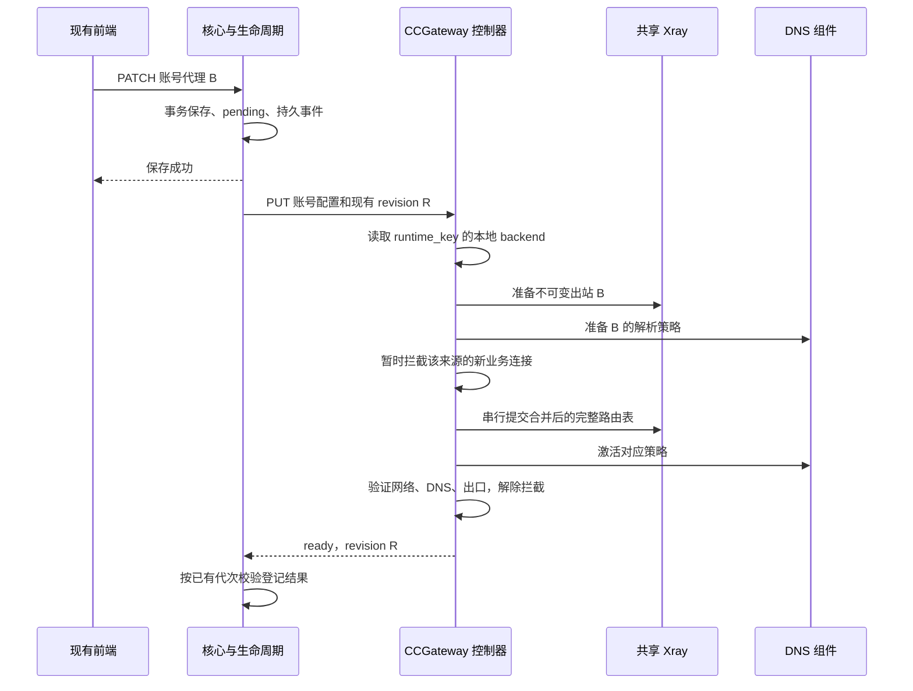

# CCGateway 代理修改端到端同步设计

实施状态（2026-10-15）：控制器与共享出口首版已实现；实际部署进度见环境运行记录。首版以 CONTRACTS 第 57 节为准：DNS 不缓存，网络池修改先回迁，旧 egress 停止保留；严格每请求版本屏障仍不在本轮范围。

日期：2026-10-15。状态：设计提案，Xray 后端尚未接入生产。

第一阶段主要修改 CCGateway 控制器和出口组件，复用现有前端保存、核心生命周期和 Worker 协议。首次切换见[控制器迁移方案](CCGATEWAY-XRAY-MIGRATION.md)，拓扑及 PoC 见[共享出口方案](CCGATEWAY-SHARED-XRAY-EGRESS.md)。

## 1. 范围与生效语义

前端仍提交账号代理，核心仍保存配置并下发，控制器根据本地 backend 更新独立 sing-box 或共享 Xray。首版不新增核心数据库表、账号 API 字段或 Worker 准入接口。

保存成功表示配置已保存。现有生命周期按控制器返回的 ready 和相同期望 revision 判定同步成功。共享后端必须把 Xray、DNS、网络身份和连通性验证纳入这个 ready。前端沿用已有状态，不新增常驻成功横幅，也不恢复已移除的可恢复额度错误提示。

普通代理切换影响新建网络连接。已有 SSE、TLS 或 HTTP/2 连接可继续经旧代理，HTTP/2 上的新流也可能沿用旧连接。首版不承诺点击保存瞬间全节点停用旧配置，也不承诺下一次模型 API 请求必定全部使用新代理。

## 2. 已有链路和修改边界

路径均相对 next/。

| 环节 | 已有实现 | 第一阶段 |
| --- | --- | --- |
| 账号编辑 | web/src/views/accounts/AccountEditor.vue 提交 PATCH /accounts/:id，代理 ID 和 URL 互斥 | 复用 |
| 事务与事件 | server/internal/account/handlers.go 更新账号、标记生命周期 pending、保存事件 | 复用 |
| 同步执行 | account/lifecycle_events.go 调用 ReconcileAccount、读取 AccountSynchronization，按代次保存结果 | 复用 |
| 代理对象更新 | proxy/proxy.go 的 notifyAccountProxyChange 通知关联账号并标记 pending | 复用，测试覆盖密码和地址修改 |
| 下发与就绪 | server/internal/ccgateway/lifecycle.go 核对 observed ready 和期望 revision | 保持合同 |
| 出口执行 | plugins/ccgateway/companions/controller/manager.py 的 apply / _activate | 增加共享后端分支 |
| 网络及探测 | controller/network.py 和新增共享出口模块 | 实现 Xray、DNS、快照恢复和探测 |
| 模型请求 | 核心隧道 → Worker → CC CLI | 保持协议 |

kickCCGateway 对声明生命周期的账号直接返回，实际同步走生命周期事件；不能只在旧式 kick 函数里补 Xray 调用。

## 3. 完整时序

旧账号继续走 sing-box 分支。已迁移账号不会因核心下发没有 backend 字段而退回旧后端。

## 4. 控制器执行与持久化

控制器按 runtime_key 保存 backend、容器/网络身份、源 IP、期望与已应用 revision、代理配置摘要、事务阶段和回滚锚点。backend 属于本地部署状态；代理选择仍以核心下发为准。

代理配置规范化后生成私有摘要和不可变出站 tag。相同配置可复用；协议、端点、凭据变化生成新 tag，不依赖核心新增 proxy_config_version。状态响应和日志不得暴露密码。

执行顺序：

1. 在账号锁下登记目标和本地操作代次，核实容器 ID、网络 ID、源 IP。
2. 准备新出站、端点防火墙许可和 DNS 策略，验证配置及代理连通性。
3. 关闭该来源的新业务连接；普通切换保留已建立连接。
4. 在共享写入锁下，从各账号当前映射合成完整路由表并提交；不能用单账号规则或旧全表覆盖其他账号。
5. 激活 DNS，用仅允许固定目标的受控探针验证路径，避免为业务开放旁路。
6. 核实操作仍是当前代次，再解除拦截并发布 ready(R)；中途故障按未完成事务恢复。
7. 旧出站和端点许可排空后回收，仍有其他账号或连接引用时保留。

多组件更新不是原子事务。关键变更前持久记录阶段，API 超时先核验实际状态，重复目标不能反复创建节点或重启 Xray。

## 5. 并发与失败边界

现有 revision 是摘要，不能比较大小推断业务先后。控制器本地代次只能防止被取代的本地任务迟到发布，不能识别多个核心节点倒序到达的业务意图。

首版复用现有生命周期代次校验及重新同步机制。验收必须证明连续保存 B、C、倒序下发和迟到回执后，实际出口最终收敛为 C。如果现有机制无法重新收敛，迁移被该缺陷阻塞，只补必要同步修复。严格拒绝所有旧下发需要核心增加单调序号，属于后续增强，不能用摘要或本地序号冒充。

| 情况 | 控制器行为 |
| --- | --- |
| 新代理认证、TLS、连通性失败 | 不报告新 revision ready；阻断受影响来源的新连接，保留诊断，不自动直连 |
| Xray 成功、DNS 失败 | 保持新连接拦截，修复到一致目标后验证 |
| 管理 API 超时 | 核验实际状态后重试 |
| 控制器重启 | 核验日志、容器、Xray 启动身份，恢复事务后发布 ready |
| Xray 重启 | 重建出站、规则和 DNS，逐账号验证；已有连接可能中断 |
| Worker 重启 | 按持久 backend 恢复网关和规则，再发布 ready |
| 账号或代理停用 | 关闭对应来源并衔接现有停用逻辑，不切换到其他代理 |

沿用核心已有生命周期状态；详细阶段保存在控制器私有诊断，不要求首版前端解析新枚举。

## 6. 隧道与网络连接

核心到 Worker 的隧道与 CLI 到模型服务的连接是两段独立连接。复用旧核心隧道，不等于 CLI 新建连接仍走旧代理；新连接会经过当前 Xray 源 IP 规则。

控制器拒绝新隧道，也不能阻止已复用隧道发送下一条请求。首版靠出口的新连接拦截控制切换，不具备 Worker 每请求准入。首次迁移通过账号维护窗口和原 app 停止/启动收束旧隧道。

若以后要求严格按每次模型请求校验版本，再扩展核心内部修订头、Worker 准入接口和租约，不作为本轮前提。

## 7. DNS 一致性

共享 DNS 按入口网络和源 IP 定位账号，接收查询时固定出站版本，缓存按代理版本与解析器隔离。查询经该版本的受限 Xray 本地入口访问 DoH，保留证书校验，不使用宿主机 DNS 兜底。

在新连接拦截期间切换 DNS 与 Xray 映射。新查询使用新版本，旧在途查询可完成；DNS 和业务路径均通过才解除拦截。这条 DNS 路径尚待实现和专项测试，TCP PoC 不能代替证明。

## 8. 端到端验收

1. 现有前端保存代理 B，不改请求结构，最终 ready revision 与核心期望一致，新 HTTPS 连接实际经 B。
2. 只修改代理对象的密码或地址，关联账号自动同步，其他账号映射保留。
3. 显式清空代理沿用直连语义；错误配置、未知来源不得变成直连。
4. 连续保存 B、C，注入倒序调用、迟到回执和通知丢失，最终状态与实际出口为 C。
5. 保留旧核心隧道，确认新 CLI 连接按当前映射出站；另测上游 HTTP/2 复用的旧出口边界。
6. SSE 期间热更新不重启共享服务，分别记录旧连接连续性、新连接出口、DNS 和认证结果。
7. 逐阶段失败、控制器/Xray 重启、Worker 更新均可恢复，不误报 ready。
8. 删除单账号、清理草稿、重新授权不破坏其他账号资源。

全部通过后才能确认现有前端到 Xray 新出口的接入完成。目前仅基础 PoC 通过。

