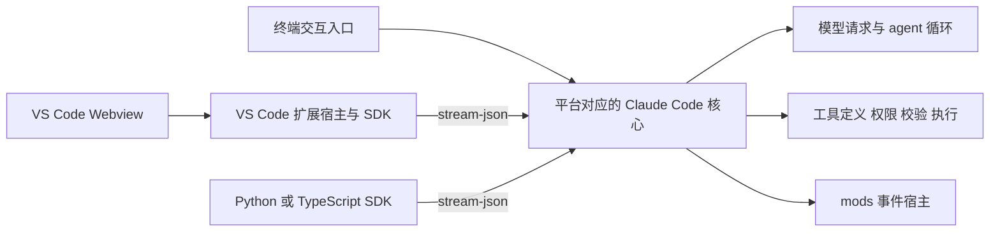

# Claude Code CLI 机制与改造指南

> 2026-10-24：本文的 CLI 机制分析（2.1.296）仍可作参考，但其中"CCGateway 经 mods 拦截工具、驱动 CLI 会话"的改造方向已不使用：native 运行时已从 Worker 删除（CONTRACTS §53.21），现在的改造是补丁加进去的 `claude request` 命令，见 [cli-mods README](../companions/cli-mods/README.md)。

本文说明 Claude Code 的发行结构、SDK 与 VS Code 接入方式、mods 事件机制、工具定义与执行路径，以及 CCGateway 后续扩展 CLI 时需要修改和验证的位置。

**分析基线为 2026-10-17 获取和验证的 Claude Code 2.1.296。** 结论不自动适用于其他版本，也不代表生产 Worker 当前使用的版本。压缩符号、模块名和文件偏移都与具体构建绑定。

当前最终补丁、产物 hash、后续审计缺陷和网关接入状态以 [2.1.296 分析与改动记录](CLAUDE-CODE-2.1.296-ANALYSIS-AND-CHANGES.md) 为准。本文保留原版机制及早期重建证据；表中的早期重编译 ELF 不等于当前 v5 最终 ELF。附件分类见 [附件分析](CLAUDE-CODE-ATTACHMENTS.md)，历史记录识别见总记录第 4 节。

当前已完成 Linux x64/glibc 的源码还原、重新编译、离线 mod 测试和一次真实文本问答。随后实现了 [native 工具注入扩展](../companions/cli-mods/README.md)：在 Linux 2.1.296 中按名称新增或完整替换工具定义，将调用直接交给 mods。普通官方 mod 接口仍不足以完成这两项功能，需要本项目修改后的 CLI。下文原函数分析描述官方基线，改造结果见第 8、9 节。

配套证据与本文一起放在插件目录中：

- [核心函数原文与偏移](cli-research/2.1.296/core-evidence.json)：16 段核心代码摘录，已逐段核对原 Windows EXE 字节；另含 VS Code 扩展启动逻辑。
- [身份与验证摘要](cli-research/2.1.296/verification-summary.json)：二进制哈希、离线检查、Docker 验证、问答结果和工具目录比较。未包含凭据、完整请求提示词或私人配置。
- [全量 mods 调用验证](cli-research/2.1.296/mods-all-tools-verification.json)：v3 扩展的目标模块哈希、8 项单元测试及 12 个 ELF 回环调用场景，包含 hooks 保留和结果改写。

## 1 结论与证据范围

| 结论 | 依据与范围 |
|---|---|
| VS Code 面板调用 CLI 核心 | Linux x64、2.1.296 的官方 npm CLI 与 VSIX 内附 CLI 大小和 SHA-256 完全一致；扩展另有前端和宿主代码 |
| 平台包的 JS 不完全相同 | Windows 与 Linux 的模块集合、原生资源、虚拟路径和固化的平台值不同 |
| tool.describe 能覆盖描述 | 宿主代码明确读取返回的 description；Linux 源码版与重编译 ELF 的 mod 测试通过 |
| tool.describe 不能直接覆盖 Schema 或名字 | 宿主 N4n 明确只返回 description 与 isDeferred；提取函数离线验证通过 |
| 模型 Schema 与执行解析器分离 | HPt、tN、W9t 的代码和离线验证 |
| 普通 mod 新增工具走 MCP | VWo 调用 addMcpServer；Ztn 建立回环 HTTP 服务；mre 强制生成 MCP 名称 |
| 内核可查找无前缀工具 | pn 根据 name/aliases 查找列表中的对象；离线验证通过。后续 native 扩展已完成 Linux headless 新增、覆盖及 mod 接管的端到端验证 |
| 已重建可运行的 Linux CLI | Bun 1.4.3 编译成功；Debian 容器通过版本、帮助、mod 测试；另一次真实文本请求成功 |

REA 完成了部分提取片段的 AST 分析，但语义图有截断，跨模块关系也不完整。本文的核心调用链同时经过直接源码核对；不将其称为完整原生反编译或完整全程序分析。

## 2 发行结构与平台差异

### 2.1 已核对的程序身份

| 程序 | 字节数 | SHA-256 |
|---|---:|---|
| 官方 Windows x64 2.1.296 | 260489376 | `76de74f7694a5bdc03378a5f837c9e132827bf004c98c276bc4e9094ff06769a` |
| 官方 Linux x64 2.1.296 | 257068216 | `24972e3bc859fab2b46ed4c1e51f7d6130f06d3bd550811a114640de3370d0de` |
| VS Code Linux x64 扩展内附 CLI 2.1.296 | 257068216 | 与上一行相同 |
| 本次重编译 Linux ELF | 146966496 | `e2bf39e055f144db93f813b4d74394c9b27e406c4a476e91935fd0bdde047f58` |

重编译文件与官方文件的大小不同，不代表功能范围已完全一致；当前验证覆盖基础启动、mod 宿主和无工具文本请求。

### 2.2 Bun 容器

目标包含 Bun 运行时、JavaScript 源码、字节码、模块元数据和资源。原生二进制反编译不是本次获取业务实现的必要步骤：可读 JS 仍保留在发行文件中。

Windows PE 的 `.bun` 段从文件偏移 `93839360` 开始，载荷从 `93839368` 开始。模块表有 2586 条记录，本版本每条 52 字节。初步按源码标记识别了 2344 个区域，其中 2343 个与模块表中的 JS 内容位置、长度和提取哈希匹配。

Linux ELF 的载荷起点为 `89120776`，模块表有 2589 条记录，其中 2345 个 JS。两者使用不同的虚拟路径：

```text
Windows  B:/~BUN/root/...
Linux    /$bunfs/root/...
```

模块表同时记录内容和字节码位置。不能假定直接替换 EXE 中的明文字符串就会改变实际执行代码。本次成功路线是从模块表恢复源码与资源，再用 Bun 重新编译。

52 字节记录及尾部布局只用于此次验证的目标。更新版本时必须先核对格式与边界，不能直接套用偏移。

### 2.3 构建时差异与运行时分支并存

平台探测器的实例化代码已经包含构建时固化值。以下仅重命名类名以方便阅读：

```javascript
// Windows 发行包
new PlatformDetector({ platform: "win32", ...sources });

// Linux 发行包
new PlatformDetector({ platform: "linux", ...sources });
```

探测器内部仍保留 Windows、macOS、Linux 与 WSL 的分支：WSL 识别读取环境标记或 `/proc/version`，Linux 发行版信息来自 `/etc/os-release`。因此，Windows 提取 JS 直接换 Linux Bun 编译，仍可能使用 Windows 行为。

系统差异还会进入具体实现：

- shell 工具根据平台、Git Bash 可用性和 PowerShell 开关筛选；Linux 包也包含 PowerShell 工具代码，存在代码不等于会向模型提供工具。
- 沙箱实现包含 Linux 的 bubblewrap 路径与 macOS 的 sandbox-exec 路径；是否实际可用还依赖系统能力和配置。
- 原生模块必须匹配系统与架构。本次 Linux 包包含 `clipboard-napi.node`、`audio-capture.node`，Windows 模块表中的原生模块集合不同。
- x64/ARM64、glibc/musl 需要匹配的发行包与运行时。

macOS 分支已在代码中观察到，但本次没有解包或运行 macOS 发行包。

### 2.4 工具集合不能只按操作系统推断

用官方 Windows/Linux 程序、隔离配置、相同模型与 CLI 参数连接本地模拟 API，捕获其实际发出的工具定义：

- Windows 本次提供 26 个工具，Linux 提供 24 个。
- 共有的 24 个工具，其 `input_schema` 逐项一致。
- 共有工具中的 Agent、Bash 描述不同，其余共有工具描述一致。
- 本次 Windows 多出的 Glob、Grep 尚未隔离出唯一原因，**不能据此形成“Linux 不支持 Glob/Grep”的规则**。

工具列表和定义还受启动模式、配置、宿主能力、远程开关以及工具依赖影响。目录匹配应以实际运行时定义为准，不能仅依赖 OS、版本号或工具名字。该探测只捕获请求，没有让模型执行任何工具。

## 3 CLI 与宿主接入



### 3.1 SDK 传递插件的方式

已读取的 Python SDK `SubprocessCLITransport._build_command()` 将：

```python
plugins=[{"type": "local", "path": "/path/to/plugin"}]
```

转换为启动参数：

```text
--plugin-dir /path/to/plugin
```

`connect()` 启动 CLI 子进程，消息通过 stdin/stdout 的流式 JSON 传输。SDK 可以附带自己的 CLI，因此复现实验时应明确指定 `cli_path`，确保运行的是所分析的文件。

该 Python 路径不意味着所有 SDK 版本都只支持 argv：本次 VS Code 扩展内的 TypeScript SDK 还存在 `pluginDelivery` 的 `argv`/`initialize` 分支。应核对所用 SDK 的实际传输实现，不把一种方式当作协议的全部。

SDK 普通 hook 回调与 mod 模块是不同通道。Python `Query.initialize()` 给宿主回调分配 `hookCallbackIds` 并发给 CLI；mod 的 JS/TS 模块则交由 CLI 的插件宿主加载。

### 3.2 VS Code 使用同一核心但另有前端

扩展包含 `extension.js`、`webview/index.js`、样式和平台 CLI。启动代码使用：

```text
--output-format stream-json --verbose --input-format stream-json
```

本次版本的扩展环境构造器设置 `CLAUDE_CODE_ENTRYPOINT=claude-vscode`，并配置 MCP 非阻塞连接、任务和启动计时等环境项。权限交互可通过 stdio 控制协议返回宿主。

终端里的 `claude` 与面板内的 CLI 是两份独立安装位置。只替换 PATH 上的程序，不会自动改变 VS Code 面板使用的程序。

扩展暴露 `claudeCode.claudeProcessWrapper`。实物函数 `mS` 和 `F7` 会将附带 CLI 路径作为 wrapper 的前置参数，再追加调用参数。接入修改版需要遵守这个约定，并验证流协议与权限回调；不能简单把任意替代 CLI 路径当作 wrapper 使用。

Remote SSH、WSL、Dev Container 下，应根据扩展宿主和 agent 进程的实际运行位置选平台，而非桌面显示器所在机器的系统。

## 4 mods 的加载与事件模型

### 4.1 模块布局

一个最小 mod 是插件目录：

```text
my-mod/
├── .claude-plugin/plugin.json
└── hooks/
    ├── hooks.json
    └── register.js
```

`hooks/hooks.json` 中的路径相对于该文件：

```json
{"modules": ["./register.js"]}
```

入口导出 `register(on, options)`。`on` 注册事件处理器，`options` 承载插件声明的配置值。可通过 `--plugin-dir` 对单次会话加载插件。

公开加载契约包含模块静态检查：事件名需用字符串字面量，导入与 mods API 调用受扫描规则约束。`claude plugin validate` 可检查注册项，`claude plugin test` 可离线运行测试。测试加载路径中观察到 `vm.SourceTextModule`，Linux 发行包另含 hooks worker；不能把 mod 加载简单等同于在主模块中执行普通 Node.js `import()`。

### 4.2 事件处理链

处理器形式为：

```javascript
async function handler($, event, next) {
  return next(event);
}
```

- `$` 是宿主提供的 mods API。
- `event` 是事件数据；按公开契约深度冻结，修改时应构造副本。
- `next(event)` 调用后续处理器，最终到达该事件的核心实现，返回其结果。
- 处理器可以修改传给 `next` 的输入、处理返回值，或按事件允许的结果结构直接回答。

多插件组成中间件链，不是简单的广播。外层处理器既能看到输入，也能处理内层返回值。公开顺序包含组织管理的前置层、用户插件、后置层和内置层；具体结果还受依赖排序、匹配条件和策略守卫影响。同一模块内的处理器按 `on` 注册顺序执行。

每种事件有独立的输入与结果契约。例如 `tool.call` 处理调用，`tool.describe` 处理模型可见描述。某个事件允许返回字段，不代表相邻事件也支持它。`Wa` 对 `tool.describe` 明确固定工具身份和 provider，并校验描述、延迟加载字段。

### 4.3 描述覆盖的完整路径

本次已运行验证的写法：

```javascript
export function register(on) {
  on('tool.describe', { tool: 'Bash' }, async ($, event, next) => {
    const result = await next(event);
    return { ...result, description: 'REBUILD_SMOKE_DESCRIPTION' };
  });
}
```

描述准备过程可以概括为：

```text
工具原始 prompt/description
  → 描述解析器
  → tool.describe 处理链
  → N4n 提取 description 和 isDeferred
  → tN 写入发给模型的工具定义
```

`N4n` 的宿主返回值只有：

```javascript
{ description: result.description, isDeferred: resolvedDeferral }
```

因此，mod 返回额外 `inputSchema` 或 `name` 不会通过这一路径进入最终工具定义。这里的限制不只是 TypeScript 类型声明，而是宿主实际的数据取用方式。

描述不是每次工具执行时都重新生成。公开契约说明它在描述首次提供给模型时触发，MCP 工具经 tool search 加载时还可能再次触发。缓存行为见第 7 节。

### 4.4 最小离线验证

`plugin test` 的底层核心行为需要测试显式提供。下面的底层处理器在插件处理链之后，不能漏掉：

```typescript
import { test, expect } from 'claude-code/testing';

test('overrides a tool description', async ($, on) => {
  on('tool.describe', ($, event) => ({ description: event.description }));
  const result = await $.tool.describe({
    tool: 'Bash',
    description: 'original',
    provider: { plugin: 'engine', tier: 'core' }
  });
  expect(result.description).toBe('REBUILD_SMOKE_DESCRIPTION');
});
```

该测试验证 mod 加载和事件调度；真实模型请求中的结果还应另行捕获。绘制能力也与 hooks 分开：非交互 `-p`/SDK 可以运行 hooks，但没有同样的终端 UI。VS Code 绘制能力还受扩展版本与功能开关限制。

## 5 工具定义与执行参数

### 5.1 三个名称不要混用

| 字段 | 所在位置 | 职责 |
|---|---|---|
| `inputSchema` | 内部工具对象 | 运行时解析器，可执行 `safeParse`/`parse`；不是普通 JSON 对象 |
| `inputJSONSchema` | 内部工具对象的可选字段 | 提供模型侧的 JSON Schema |
| `input_schema` | 发给模型的 Messages 工具定义 | 最终序列化的协议字段 |

`HPt` 优先使用 `inputJSONSchema`，缺省时由内部 `inputSchema` 转换，然后应用特定字段过滤。`tN` 分别取得 Schema 和经过 mods 处理的描述，再构造：

```javascript
{
  name: tool.name,
  description: described.description,
  input_schema: modelSchema
}
```

strict 模式可能继续转换 Schema；历史记录中的定义也可能覆盖本次生成的值。修改点不能只选最终对象构造的一行而忽略其他来源。

### 5.2 参数值覆盖不等于 Schema 覆盖

`tool.call` 可以把某次调用的参数副本传给 `next`，这不会自动改变模型看到的参数定义。`tool.describe` 处理描述，同样没有把参数定义连接进来。

内部 `W9t` 的关键顺序是：

```text
输入
  → 可选 coerceInput 适配
  → inputSchema.safeParse
  → 解析后的参数
```

提取函数测试已复现：模型 Schema 使用 `script`，执行解析器仍要求 `command` 时会拒绝；通过内部 `coerceInput` 将 `script` 转换成 `command` 后能通过该解析函数。

这只证明适配器在此函数中的可行性。完整调用还可能经过更早的参数规范化，以及 `validateInput`、权限匹配、日志和执行器；例如 Bash 的其他路径也会直接读取既有 Schema。端到端实现必须验证这些阶段接收的参数契约一致。

### 5.3 覆盖需求的不同范围

| 改动 | 最少需要处理的层 |
|---|---|
| 工具整体描述 | tool.describe 与描述缓存 |
| 参数字段描述，结构不变 | 模型 JSON Schema、strict 转换和定义缓存 |
| 字段改名、类型或必填约束变化 | 模型 Schema、输入校验或适配、权限和执行器契约 |
| 改变工具行为 | 工具调用处理、权限、返回结果和客户端显示 |

若继续使用原执行器，需要保证模型定义与执行定义一致。本项目后续按用户要求采用另一条实验路径：完整覆盖定义并将执行交给 mods，主调用路径绕过原解析和权限检查；无人接管时明确报错，不调用原执行器。其范围与缺口见当前总记录。

## 6 新增工具的两条路径

### 6.1 普通 mod 注册的是 MCP 工具

当前 `$.tool.register()` 的实际路径：

```text
VWo 校验并登记插件工具
  → vht 取得注册器
  → Ztn 建立回环 HTTP 服务
  → addMcpServer 添加动态服务
  → 等待工具出现在会话列表
```

`Ztn` 使用 `Bun.serve` 监听 `127.0.0.1` 的随机端口。`Ytn` 提供 MCP 的工具目录，其中包括描述和 JSON Schema。调用通常由 mod 的 `tool.call` 接管；无人处理时，服务返回“未提供 tool.call 处理器”的错误。

名称函数为：

```javascript
mre = (server, name) => `mcp__${In(server)}__${name}`;
```

所以，即使没有独立外部 MCP 进程，也仍走 MCP 注册和命名路径。仅修改这一个前缀函数并不足以完成本地工具接入，相关目录、身份、权限与分发仍带有 MCP 语义。

### 6.2 本地工具通过对象列表和名称索引分发

已定位的原生工具路径：

```text
rv 构造工具对象列表
  → ZL 按模式 权限 isEnabled 等筛选
  → 模型工具定义序列化
  → pn 根据 name 或 aliases 查找工具
  → 校验 权限 执行 返回结果
```

`Kt` 负责包装部分本地工具的生命周期，将 `create`、`call`、`validateInput`、`checkPermissions` 等行为接到会话上下文。

`pn` 没有要求名字必须带 MCP 前缀。离线验证中，已加入列表的 `SearchCode` 可以被找到。但“能找到”不等于已具备完整工具能力：新增工具还需接入真实会话目录，定义输入、输出、权限行为、执行上下文和必要的显示逻辑。

对 CCGateway 而言，还必须明确新增工具是在 Worker 执行，还是只向模型提供定义并将调用交还客户端。不能因为接入了 CLI 本地工具表，就改变现有客户端工具的执行归属。现有职责参见 [配套组件说明](../companions/README.md)。

## 7 缓存与会话生命周期

| 缓存或记录 | 已观察到的行为 | 改造要求 |
|---|---|---|
| 描述解析与延迟加载状态 | TK 管理解析器、描述与 deferral；gHs 为 invalidateToolDescriptions | 修改描述或放置策略后触发相应失效 |
| mods 失效队列 | ui.invalidate 对 tool.describe 排队，Kye 调用描述和工具列表描述缓存失效函数 | 不把请求失效等同于所有 Schema 缓存均已刷新 |
| 工具序列化 | tN 使用 EAe 缓存；自定义 inputJSONSchema 参与 Schema key | 新旧定义必须有正确的缓存身份 |
| 已记录的定义 | recordedEntry/recordedDescription 可影响后续发送值 | 明确本次覆盖是否作用于已有会话与 resume |
| 名称查找 | pn 对工具数组身份使用 WeakMap/WeakSet | 更新列表时应替换数组或显式维护索引 |

离线测试已验证：查找缓存建立后原地 `push` 新工具，可能查不到；传入包含新工具的新数组可重新索引。不要只改全局列表而让主会话、子代理或缓存继续引用旧数组。

## 8 定位后续修改

以下符号与偏移均指**上述哈希的 Windows 2.1.296 EXE**。偏移是原文件字节位置，不是虚拟地址；Linux 应按语义重新定位。完整原文见 [core-evidence.json](cli-research/2.1.296/core-evidence.json)。

| 符号 | 文件偏移 | 用途 |
|---|---:|---|
| Wa | 215418321 | tool.describe 输入与结果契约 |
| N4n | 220742004 | 描述处理链的宿主返回值 |
| HPt | 221104118 | 模型侧 Schema 选择与过滤 |
| tN | 221108820 | 工具请求序列化、strict、缓存及记录 |
| W9t | 222429240 | 输入适配与运行时 Schema 解析 |
| mre | 220740323 | MCP 名称生成 |
| VWo | 222598548 | mod 工具注册与动态 MCP 接入 |
| Ytn | 222746365 | 进程内 MCP 工具目录与未处理调用 |
| Ztn | 222747859 | 回环 MCP HTTP 服务 |
| rv | 228552026 | 本地工具初始列表 |
| ZL | 228552988 | 工具列表筛选 |
| Kt | 216530928 | 本地工具生命周期包装 |
| pn | 216530235 | 工具名称及别名查找 |
| Kye | 222654750 | 描述相关失效操作 |

实现采用统一的 `$.tool.register({ kind: "native", name, description, inputSchema })` 扩展：同名完整替换，不存在则添加。这个字段是本项目新增的，不是官方 API。注册表按会话隔离，后注册的同名定义生效。

按最终确定的执行边界，**所有模型 tool_use 都由 mods 接管**，包括未替换的原内置工具、MCP 工具以及未登记名称。mod 自己校验和执行参数；宿主跳过内置验证及原工具权限链，**保留配置的 PreToolUse、PostToolUse、PostToolUseFailure**。hook 主动拒绝或修改参数仍生效。未被 mod 接管时允许报错，不回落到原执行器。不含 `kind: "native"` 的注册仍走官方 MCP 定义路径，但调用同样交给 mods。

Linux 补丁位置：

| 位置 | 改造 |
|---|---|
| `chunk-30jbnw20.js` 的 CT | guest 注册桥接保留 kind 字段；复用现有 tool.register 操作，无需新增操作名 |
| `chunk-kasbfbhj.js` 的 BWo | native 注册写入会话表，不进入 addMcpServer |
| headless 的 ta、terminal 的 computeToolPool | 最终合并 mod 工具，更新缓存修订号，不再经过旧列表权限过滤 |
| sN | 直接序列化 mod 定义，避免原工具 Schema、记录缓存和专用转换覆盖它 |
| eYt、Gle、vwt | 所有工具跳过更早的响应参数规范化；vwt 原本会按 Bash 名称调用原 Bash 解析器 |
| chunk-716kq0mx.js 的 n5t | 不提前拆解批量工具包装调用，由 mod 接收原始调用 |
| chunk-daj64yn4.js 的 addTool | 移除流式队列中的名称存在性检查和旧 Schema 并发判断；统一串行排队 |
| Xj / tool-dispatch.inc.js | 全量替换调度入口，调用配置的前置 hooks，再进入 mods tool.call，成功/失败分别执行后置 hooks；不装配原工具执行及权限 core |

另核对了 Ccs → QOn 的 Bash 专用提前检查：判断包含名称/别名、远程调用和主 agent 条件，但该 Linux 构建的 b5t 固定返回 false，因此这段专用检查在此构建中不可达。不能仅因源码保留检查就宣称它运行；本扩展直接分流后也不经过此入口。

代码、类型说明、构建脚本和测试位于 [companions/cli-mods](../companions/cli-mods/README.md)。尚未增加 unregister API；恢复会话时由 mod 重新注册。子 agent、ToolSearch、完整历史恢复和交互界面仍需专项验收。其他平台应按自己的构建重新定位，不能照搬压缩符号或偏移。

## 9 重建与验证

### 9.1 已跑通的路线

1. 获取同版本、同平台官方 npm 包，核对 `dist.integrity` 与二进制哈希。
2. 按 Bun 模块表恢复 JS、文本资源、二进制资源与原生模块。
3. 将虚拟模块引用改为本地可解析引用。
4. 恢复文本与文件资源的加载类型；将可静态识别的 `import.meta.require` 及其别名调用转换为可打包的 `require`。
5. 用 Bun 1.4.3 运行源码，再执行 `bun build --compile`。
6. 先验证本地宿主与模拟 API，再进行受控真实模型请求。

初次 Windows 重建的失败说明了步骤 4 的必要性：打包器漏收 `import.meta.require` 依赖；文本资源还一度以模块对象而非字符串传入 SourceTextModule。后续 Linux 提取器显式恢复了这些语义，源码与 ELF 的 mod 测试均通过。Windows 的修复版仍需单独构建验证，不能沿用 Linux 的成功结论。

### 9.2 本地研究产物

仓库根目录下的 `artifacts/claude-mods-research-20261017/` 保存大体积材料，当前未纳入本次文档的版本控制范围：

| 相对研究目录的路径 | 内容 |
|---|---|
| `restore-bun.cjs` | 从核对过布局的 Bun 二进制恢复源码；当前 Babel 依赖路径绑定本机，迁移时需调整 |
| `module-index.json`、`manifest.json` | Windows 模块位置与提取哈希 |
| `verify-core.cjs`、`proof-functions.ndjson` | 原函数离线验证；依赖受控桩及本机 Zod |
| `linux-x64/restored/` | 可由 Bun 运行的 Linux JS 模块和资源 |
| `linux-x64/build.sh`、`build-test.cjs` | Linux 编译与宿主验证 |
| `linux-x64/smoke-mod/` | 已通过的 mod 夹具 |
| `linux-x64/claude-linux-rebuilt` | 已验证 ELF |
| `linux-x64/Dockerfile` | Debian 运行镜像配置 |
| `platform-comparison/runtime-probe.cjs` | 回环模拟 API 工具定义捕获器 |

模块包不是单个自足 JS 文件。运行 `restored/cli.js` 必须保留相邻模块和资源。

在已经恢复的 Linux 目录中：

```sh
bun restored/cli.js --help
bun restored/cli.js plugin test smoke-mod
bun build restored/cli.js restored/src/plugins/functionHooks/hooks-worker/hooks-worker.js --compile --outfile claude-linux-rebuilt
./claude-linux-rebuilt --version
./claude-linux-rebuilt plugin test smoke-mod
docker build -t claude-rebuilt:2.1.296-local .
```

构建命令现已补上独立 hooks-worker 入口。后续实际工具调用测试发现：仅编译 cli.js 的旧基线 ELF 虽能通过 plugin test，但真实会话的 worker 会报 ModuleNotFound。扩展构建已修复并通过真实 worker 的回环调用测试。当前输入提取仍依赖研究脚本，尚未整理成完全独立的源码工程。

### 9.3 验证状态与后续验收

已完成的验证：

- 16 段持久化函数摘录与原 EXE 对应字节一致。
- 7 项提取函数离线检查通过，包括描述结果字段、两层 Schema、输入适配和名称索引缓存。
- Linux 源码版和重编译 ELF 均通过版本、帮助与 tool.describe mod 测试。
- 不另装 Bun 的 Debian 容器通过版本、帮助与 mod 测试。
- 重编译 ELF 完成一次无工具真实请求，返回 `7 times 8 is **56**.`。

尚未覆盖完整交互 UI、音频、剪贴板、远程执行和所有内置工具。一次文本问答不等于这些功能已兼容。

native 扩展新增的验证状态：

| 场景 | 应验证的结果 |
|---|---|
| Schema 与名称覆盖 | Linux headless ELF 已验证：模型收到新描述和完整 Schema，名称无 MCP 前缀 |
| 参数不经旧解析器 | 已验证：script 及 Schema 之外的 extra 原样到达 mod；日志没有旧工具规范化错误 |
| 原权限与 hooks 分离 | 已验证主路径：disallowedTools、--tools 空列表不阻断注入工具；原工具、禁用工具及未知名称也可分发。v3 恢复 hooks adapter，部分前置/后置行为通过；后续发现 ask、mods context 等兼容缺口，不代表所有 hooks 语义兼容 |
| 同名再次注册 | 已验证：调用中更新定义，下一轮只有一份新描述、新 Schema |
| 无人接管 | 已验证：返回未实现错误，不回落到原 Bash |
| 普通 MCP 注册 | 已验证：仍带前缀，调用结果由 mod 返回，不访问原执行器 |
| 原工具与未知名称 | 已验证：未替换的 Bash、Read、TaskCreate、WebFetch 以及未知名称，都能接收不匹配旧 Schema 的参数并交给 mod |
| 会话隔离与缓存 | 单元测试验证不同会话隔离、完整替换和数组缓存更新 |
| 卸载、resume、子代理、ToolSearch、交互界面 | 尚未做完整端到端验收；见扩展 README 的范围说明 |
| CCGateway Go 引擎接入与 Worker 切换 | 尚未启用；当前交付 CLI 扩展与独立 mod 示例 |
| 多平台 | 当前只实现并运行验证 Linux x64/glibc 2.1.296 |

远端研究目录为 `ovh:/tmp/claude-rebuild-i2CL6DQC`，镜像标签为 `claude-rebuilt:2.1.296-local`。它们属于临时研究环境，不是发布位置，也不保证长期保留。未向生产 Worker 部署修改版 CLI。

## 10 外部参考

下列接口文档会随版本变化。本地二进制证据优先用于解释 2.1.296 的实际行为；新版本应重新核对。

- [Bun 单文件可执行程序](https://bun.com/docs/bundler/executables)
- [Bun 模块图布局源码](https://github.com/oven-sh/bun/blob/main/src/standalone_graph/StandaloneModuleGraph.rs)
- [Claude Agent SDK 概览](https://code.claude.com/docs/en/agent-sdk/overview)
- [Python SDK 子进程传输实现](https://github.com/anthropics/claude-agent-sdk-python/blob/main/src/claude_agent_sdk/_internal/transport/subprocess_cli.py)
- [Python SDK 控制协议实现](https://github.com/anthropics/claude-agent-sdk-python/blob/main/src/claude_agent_sdk/_internal/query.py)
- [mods 接口参考](https://code.claude.com/docs/en/plugins/mods/reference)
- [mods 事件与处理链](https://code.claude.com/docs/en/plugins/mods/events)
- [mods API 与工具注册](https://code.claude.com/docs/en/plugins/mods/api)
- [mods 加载与开发检查](https://code.claude.com/docs/en/plugins/mods/create)
- [mods 在不同宿主中的支持范围](https://code.claude.com/docs/en/plugins/mods/overview#where-mods-run)
- [Claude Code 的 VS Code 集成](https://code.claude.com/docs/en/vs-code)
- [VS Code 扩展宿主](https://code.visualstudio.com/api/advanced-topics/extension-host)
